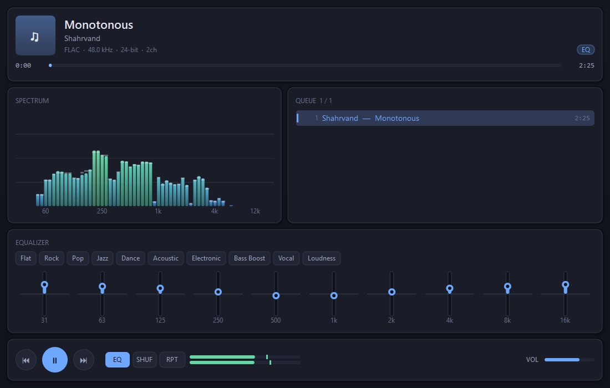
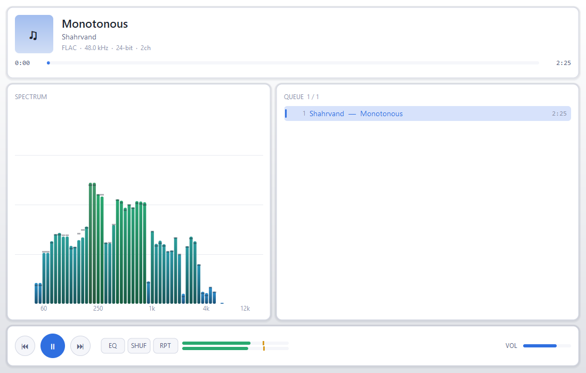

# zmp

A music player written in Zig, with native decoders, a real-time DSP chain and
a low-latency Windows audio backend. It ships as two front ends over one
engine: a terminal player and a desktop one.



```
╭─ zmp ──────────── WASAPI Speaker (Realtek(R) Audio) — 48000 Hz 2ch f32 ─╮
│                                                                         │
│  ▶  Blue in Green                                                       │
│     Bill Evans — Kind of Blue                    FLAC 44.1 kHz / 16-bit │
│                                                                         │
│  1:23 ━━━━━━━━━━━━━━━━━━━●──────────────────────────────────────  5:37  │
│                                                                         │
│  playing  3/12  vol 70%  shuffle  repeat all  eq            buf 94%     │
╰─────────────────────────────────────────────────────────────────────────╯
╭─ Spectrum ──────────────────────────╮╭─ Queue 3/12 ─────────────────────╮
│          ▂▄█                        ││   1  Miles Davis — So What  9:22 │
│      ▂▄▆███▆▄▂                      ││   2  Freddie Freeloader     9:46 │
│   ▁▃▅███████████▅▃▁                 ││ ▸ 3  Blue in Green          5:37 │
│  ███████████████████▇▅▃▁            ││   4  All Blues             11:33 │
│  31  125  500  2k  8k  16k          ││   5  Flamenco Sketches      9:26 │
╰─────────────────────────────────────╯╰──────────────────────────────────╯
 L ████████░░░░  R ███████░░░░░   space play  n/p track  ? help  q quit
```

## Two interfaces, one engine

| | |
| --- | --- |
| `zmp` | terminal player: full-screen TUI, keyboard driven, works over SSH |
| `zmp-gui` | desktop player: window, mouse, drag-and-drop, custom-drawn |

Everything below the presentation layer — decoding, resampling, the DSP chain,
the playlist, the audio backends, the threading model — is shared. The desktop
interface is about 2,900 lines on top of that; it adds no audio code at all.

## What it does

- **Decoders written from scratch** for WAV and FLAC, verified bit-exact
  against ffmpeg on real encoder output. MP3/MP2 uses the vendored
  public-domain [minimp3](https://github.com/lieff/minimp3).
- **Sample-accurate seeking** in every format, including MP3.
- **Low-latency Windows output** over WASAPI in shared, event-driven mode,
  with waveOut as a fallback and a null sink so the player runs anywhere.
- **Real-time DSP**: a ten-band equalizer, smoothed volume with
  constant-power balance, a look-ahead brickwall limiter, and windowed-sinc
  resampling.
- **Gapless playback** across tracks of the same format.
- **Tags** from ID3v2.2/2.3/2.4, Vorbis comments and RIFF INFO, including
  ReplayGain.
- **A terminal interface** with a spectrum analyzer, level meters, a
  navigable queue and an equalizer editor, drawn with a diffing cell renderer
  so it does not flicker.
- **Offline rendering** to a 24-bit WAV, which is transparent end-to-end: with
  the EQ off and volume at unity, the output is bit-identical to a reference
  decode.
- **A desktop interface** drawn entirely in software — anti-aliased rounded
  panels, gradients, alpha blending — with drag-and-drop, a draggable seek bar
  and a ten-band equalizer you can grab with the mouse.

## Building

Requires Zig 0.17.0.

```sh
zig build                 # -> zig-out/bin/zmp and zig-out/bin/zmp-gui
zig build run -- FILES    # build and play in the terminal
zig build gui -- FILES    # build and play in a window
zig build test            # 280 tests
zig build bench           # DSP microbenchmarks
```

Build options:

| Option | Default | Effect |
| --- | --- | --- |
| `-Dmp3=false` | on | drop MP3 support and the C dependency |
| `-Dwasapi=false` | on (Windows) | drop the WASAPI backend |
| `-Dwinmm=false` | on (Windows) | drop the waveOut backend |
| `-Doptimize=ReleaseFast` | Debug | optimized build |

With `-Dmp3=false` the project is pure Zig and needs no libc.

## Using it

```sh
zmp song.flac                      # play one file
zmp ~/music/albums/kind-of-blue    # play a directory, in track order
zmp set.m3u8                       # play a playlist
zmp --shuffle --repeat all ~/music # shuffle everything
zmp --eq bass_boost song.mp3       # with an equalizer preset
zmp --tone sweep:20-20000          # a 20 Hz to 20 kHz sweep, no file needed
```

Directories are scanned recursively and sorted naturally, so `track2` comes
before `track10`.

### Keys

| Key | Action |
| --- | --- |
| `space` | play / pause |
| `n` / `p` | next / previous track |
| `enter` | play the selected track |
| `←` `→` | seek 5 seconds |
| `[` `]` / `{` `}` | seek 30 / 60 seconds |
| `0` | restart the track |
| `↑` `↓`, `j` `k` | move the queue cursor |
| `pgup` `pgdn`, `g` `G` | page, first, last |
| `d`, `del` | remove the selected track |
| `esc` | follow the playing track again |
| `+` `-` | volume |
| `m` | mute |
| `e` | equalizer on/off |
| `E`, `F2` | equalizer editor |
| `l` | output limiter on/off |
| `s` | shuffle |
| `r` | repeat: off / all / one |
| `t` | cycle theme (dark / light / mono) |
| `ctrl+l` | force a full redraw |
| `?`, `F1` | help |
| `q`, `ctrl+c` | quit |

### Diagnostics

```sh
zmp --list-devices              # output devices and their ids
zmp --probe song.flac           # format details and tags
zmp --verify-seek song.flac     # check that seeking is sample accurate
zmp --raw song.flac > out.f32   # decode to 32-bit float PCM on stdout
zmp --render out.wav song.flac  # render through the DSP chain to a file
zmp --dump-ui --size 110x30 DIR # print one frame of the interface and exit
```

`--raw` is how the decoders were validated: piping it alongside
`ffmpeg -i song.flac -f f32le -` and comparing the two streams.

Run `zmp --help` for the full option list.

## The desktop interface

```sh
zmp-gui                            # empty window; drop files onto it
zmp-gui ~/music/kind-of-blue       # open a folder
zmp-gui --eq rock --theme light song.flac
```

Files and folders can be dropped onto the window at any time. The seek bar,
volume slider and every equalizer band are draggable; double-clicking a queue
row plays it, and double-clicking an equalizer band resets it to 0 dB. The
keyboard shortcuts mirror the terminal player's where they make sense
(`space`, `n`/`p`, arrows, `+`/`-`, `m`, `s`, `r`, `e`, `t`, `q`).



`--screenshot FILE.bmp` renders a single frame offscreen and exits, which is
how the layout above was reviewed and is checked for regressions.

## How it is put together

```
src/
  main.zig          entry point and the diagnostic modes
  cli.zig           argument parsing
  audio/
    backend.zig     output abstraction and device enumeration
    wasapi.zig      WASAPI, with hand-written COM vtables
    winmm.zig       waveOut fallback
    null_sink.zig   real-time-paced silent output
    wav_sink.zig    offline render to a file
    ring.zig        wait-free SPSC ring buffer
    format.zig      sample formats and channel mapping
  decode/
    decoder.zig     content-based probing and dispatch
    wav.zig         RIFF/WAVE
    flac.zig        native FLAC decoder
    mp3.zig         minimp3 binding
    tone.zig        synthesized signals
    source.zig      memory-mapped file access
  dsp/
    biquad.zig      second-order sections, RBJ designers
    equalizer.zig   ten-band EQ and presets
    resample.zig    polyphase windowed-sinc conversion
    gain.zig        volume, mute, constant-power balance
    limiter.zig     look-ahead brickwall limiter
    fft.zig         radix-2 FFT and windows
    analyzer.zig    spectrum and level metering
    chain.zig       the processing graph
  player/
    engine.zig      threads, buffering, transport
    playlist.zig    queue, shuffle, repeat
    library.zig     directory scanning and M3U
  meta/tags.zig     ID3v2, Vorbis comments, RIFF INFO
  ui/
    term.zig        terminal setup and keyboard input
    screen.zig      diffing cell renderer
    theme.zig       palettes
    app.zig         layout and interaction
  gui_main.zig      desktop entry point
  gui/
    win32.zig       window, message loop and GDI bindings
    canvas.zig      software renderer over a BGRA pixel buffer
    theme.zig       desktop palettes
    app.zig         layout and interaction
```

### Why the desktop interface draws itself

The window is a single 32-bit DIB section that the player renders into pixel
by pixel, blitted once per frame. GDI — the drawing API that comes with a
plain Win32 window — has no alpha blending, no anti-aliasing and no gradients,
all of which this interface leans on heavily, and reaching for Direct2D or a
GUI toolkit would mean a dependency far larger than the renderer itself.

Rounded rectangles and circles are anti-aliased analytically: for each pixel
the signed distance to the shape's edge becomes an alpha value, which is exact
enough at these sizes and needs no supersampling pass.

Text is the one exception — it goes through GDI onto the same surface, because
reimplementing font rasterization and hinting to the standard a desktop user
expects is not a reasonable trade.

### Threading

Three threads touch the engine, with a strict division of labour:

| Thread | Owns | May block? |
| --- | --- | --- |
| UI / CLI | the playlist, all user commands | yes |
| decoder | opening files, decoding, resampling | yes |
| audio | draining the ring, the DSP chain, the device | **never** |

The audio thread must finish inside one device period on every invocation, so
it does no allocation, no locking, no syscalls and no file I/O. Two structures
make that work:

- The **ring buffer** between the decoder and the audio thread is wait-free
  single-producer / single-consumer, so the two never contend.
- Settings the audio thread owns (volume, EQ, limiter) are changed by pushing
  onto a second wait-free queue, which the audio thread drains at the top of
  each callback. Writing filter coefficients directly from the UI thread would
  be a data race on values the audio thread reads mid-block.

The DSP chain runs *in* the audio callback rather than in the decoder, so a
volume or EQ change is heard immediately instead of after a second and a half
of buffered audio has drained.

Seeking uses a short handshake: the decoder asks the audio thread to stop
reading, waits for the acknowledgement, then clears the ring — which is the
only point at which a single-consumer structure can safely be reset.

### Some decisions worth explaining

**Files are memory-mapped, not read into a buffer.** That keeps the decoders as
pure functions over a `[]const u8` — trivially testable, with free random
access for seeking — while the operating system pages the file in on demand
instead of committing a whole album to RAM.

**The limiter takes the stricter of its smoothed gain and the exact gain each
frame needs.** A smoothed envelope alone is only asymptotic, so a sample would
occasionally slip over the ceiling. The look-ahead has already walked the
smoother close to the right value, so the exact bound almost never binds and
the envelope stays smooth — but the ceiling becomes a guarantee.

**The volume control is cubic in fader position.** Loudness perception is
roughly logarithmic, so a linear fader spends most of its travel in a range
that sounds the same.

**`WAVEFORMATEX` is declared byte-packed.** Microsoft documents `cbSize = 22`
for `WAVEFORMATEXTENSIBLE`, which is exactly `40 - 18` and only holds if the
base struct carries no trailing padding. Letting Zig pad it to 20 bytes would
shift every extension field and silently misread the subformat GUID. There is a
test pinning the sizes.

**An offline render waits instead of emitting silence.** A file sink pulls as
fast as memory allows, so the usual "fill with silence on underrun" behaviour
would write the whole output before anything had been decoded. Having no
deadline is exactly what makes waiting safe there.

## Testing

```sh
zig build test
```

280 tests, all hermetic — no fixture files, no audio device, no network. The
notable ones:

- **Measured against predicted filter responses.** A sine is run through each
  biquad and the settled amplitude compared with the analytic transfer
  function.
- **The resampler is checked for amplitude, frequency and anti-aliasing.** A
  20 kHz tone downsampled to 24 kHz must be attenuated by more than 40 dB
  rather than folded back to 4 kHz.
- **FLAC is tested against hand-built bitstreams.** The test suite contains a
  small FLAC *writer*, so the container, frame headers, CRC-8 and CRC-16,
  subframes and every bit depth are exercised through the real decode path.
- **The sliding-window maximum is compared against a brute-force scan** over
  random input.
- **The engine is tested end-to-end** through the null sink: playback, gapless
  track advance, pause and resume, seeking, skipping an unreadable file,
  resampling, and command delivery to the audio thread.
- **The terminal interface is rendered into a buffer** and asserted on as
  text, across three themes and twenty terminal sizes.
- **The desktop interface's geometry, colour maths and Win32 struct layouts**
  are pinned by tests, including the UTF-16 conversion that `std` would
  otherwise panic on.

The decoders were additionally validated against ffmpeg on real encoder
output. WAV at every supported bit depth and FLAC at 16 and 24 bits, in stereo
and mono, decode **bit-exactly** — including mid/side stereo decorrelation and
LPC subframes. MP3 agrees to within -101 dBFS RMS, which is below the 16-bit
noise floor and is the expected result for two independent implementations of
a lossy codec. Seeking was checked for sample accuracy in all four formats.

## Limitations

- WASAPI and waveOut are Windows-only. On other platforms the terminal player
  builds and runs, but the only outputs are the null sink and `--render`;
  adding ALSA, PulseAudio or CoreAudio means one new file implementing
  `audio/backend.zig`'s vtable.
- The desktop interface is Windows-only outright, since it is built on Win32
  and GDI. The renderer in `gui/canvas.zig` is platform-independent, so a port
  would need a window and a way to blit a pixel buffer, not a rewrite.
- No album art: the tag readers skip embedded images, so the artwork tile is a
  placeholder.
- No Opus, Vorbis, AAC or ALAC.
- The renderer counts one column per code point, so East Asian wide
  characters under-count and a title containing them is clipped early. The
  layout clips rather than wraps, so the frame stays intact.
- Crossfading between tracks is not implemented; track transitions are gapless
  but not overlapped.
- `--tone` occupies one queue slot and ignores any files given alongside it.

## Licence and third-party code

`vendor/minimp3` is [minimp3](https://github.com/lieff/minimp3) by Lion
(lieff), released into the public domain under CC0 1.0; its licence text is
included alongside it. It is vendored unmodified, with a small C shim
(`vendor/minimp3/zmp_mp3.c`) that exposes a narrow interface so the Zig side
never has to mirror its struct layouts.

Everything else is original to this project.
